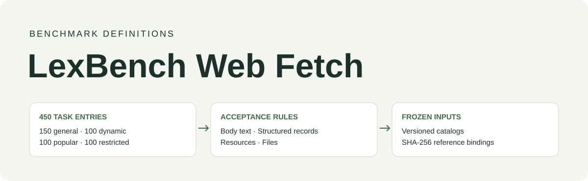
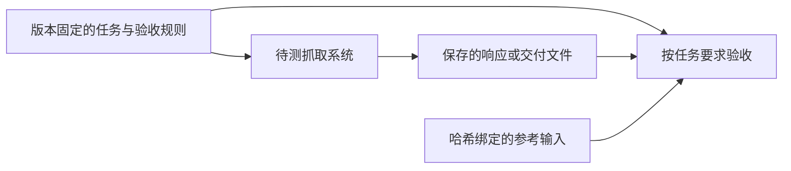

<div align="center">



# LexBench Web Fetch

### 抓取成功后，究竟拿到了什么？

为网页正文、结构化记录和文件抓取提供版本固定的任务与验收规则。

[English](../README.md) · 简体中文

[](https://github.com/lexmount/lexbench-webfetch/actions/workflows/ci.yml)
[](../LICENSE)
[](../pyproject.toml)

[任务集](#任务集) · [快速开始](#快速开始) · [评测协议](protocol.md) · [参与贡献](../CONTRIBUTING.md)

</div>

---

LexBench Web Fetch 规定抓取系统需要交付哪些内容：网页正文、名称与链接对应的记录、指定资源，或可用的文件。任务的验收规则区分“请求成功”和“交付内容符合要求”。

这个 benchmark 独立于浏览器、服务商和执行脚手架，不依赖 Browser Eval。可以用自己的工具读取 JSON 任务定义，也可以导出经过校验的输入，交给 [Browser Eval](https://github.com/lexmount/browser-eval) 执行。



## 任务集

| 任务集 | 任务记录数 | 范围 |
| --- | ---: | --- |
| `webfetch` | 150 | 网页、文档、图片、视频和挑战页面 |
| `dynamic-content` | 100 | 初始页面响应后加载的正文与记录 |
| `popular-sites` | 100 | 常用网站上与任务相关的内容 |
| `access-restrictions` | 100 | 曾观察到访问限制的网址 |

四组任务分别固定版本，共 450 条任务记录，不代表去重后的 450 个网站，也不直接合成总榜。访问限制描述的是历史观察，网址今天的表现可能不同。WebMainBench、WCXB 和 WebArena 仍是各自独立的上游 benchmark。

每组提供可读的 `tasks.json`、包含原始完整任务哈希的目录，以及绑定可执行数据集和参考文件的清单。详见[数据结构与使用权](data.md)。任务原文和冻结的验收规则保留原语言。

## 快速开始

安装 [uv](https://docs.astral.sh/uv/getting-started/installation/)，然后运行：

```sh
git clone https://github.com/lexmount/lexbench-webfetch.git
cd lexbench-webfetch
uv sync --frozen
uv run --frozen lexbench-webfetch list
uv run --frozen lexbench-webfetch validate
```

这一步检查公开任务定义，无需浏览器、API Key 或 Browser Eval。它不访问网站，也不计算评测分数。

复现冻结任务集需要取得获准使用的原始输入。所需文件及哈希列在 `src/lexbench_webfetch/suites/<suite>/source-inputs.json` 中。本仓库不分发第三方页面快照，目前也没有公开的完整输入下载包。

```sh
uv run --frozen lexbench-webfetch verify-inputs \
  --suite webfetch --source /absolute/path/approved-inputs
uv run --frozen lexbench-webfetch export \
  --suite webfetch --source /absolute/path/approved-inputs \
  --output /absolute/path/new-input-directory
```

导出工具只复制清单内的文件，并打印可执行数据集路径。缺文件、内容变化或符号链接都会使校验失败，已有输出目录不会被复用。

## 执行评测

执行工具读取任务网址与提示词，保存响应或文件，再按任务规则和已校验的参考输入验收。记录 benchmark 提交版本、任务集 ID、输入哈希、待测方法版本、执行策略和评分器版本。分数与耗时的报告方式见[评测协议](protocol.md)。

如果已在另一目录安装 Browser Eval，可在 Browser Eval 根目录运行：

```sh
uv run --frozen browser-harness-eval validate \
  --dataset /absolute/path/new-input-directory/dataset.json
uv run --frozen browser-harness-eval run \
  --dataset /absolute/path/new-input-directory/dataset.json \
  --provider-config configs/providers.quickstart.json --providers http
```

普通运行用于诊断。正式比较实时网站时，还需要完成调用前后的参考内容认证。输入校验只能证明文件版本相符，不能证明网站今天仍然符合旧参考。详见 [Browser Eval 接入说明](https://github.com/lexmount/browser-eval/blob/main/docs/benchmarks.md)。

## 仓库内容

| 路径 | 用途 |
| --- | --- |
| `src/lexbench_webfetch/suites/` | 任务定义、目录和冻结输入清单 |
| `src/lexbench_webfetch/benchmark.py` | 独立的定义检查与输入导出 |
| `docs/protocol.md` | 验收、证据、耗时和结果报告规则 |
| `tests/` | 输入接受、拒绝及导出行为测试 |

浏览器适配器、凭据、实测结果、报告生成器和托管配置由执行脚手架或外部证据存储管理。本仓库没有实测排行榜。任务要求的修改在这里维护；通用执行或评分实现的问题在对应脚手架修复。

## 参与贡献与引用

修改任务或提交结果前，请阅读 [CONTRIBUTING](../CONTRIBUTING.md)。`make check` 会检查任务定义和输入工具。安全问题请参阅 [SECURITY](../SECURITY.md)。

引用 [LexBench Web Fetch](../CITATION.cff) 时，请记录具体提交版本和任务集；执行脚手架单独引用。项目自有代码和任务定义采用 [MIT 许可](../LICENSE)，第三方原始材料保留各自使用条件，详见 [THIRD_PARTY](../THIRD_PARTY.md)。
